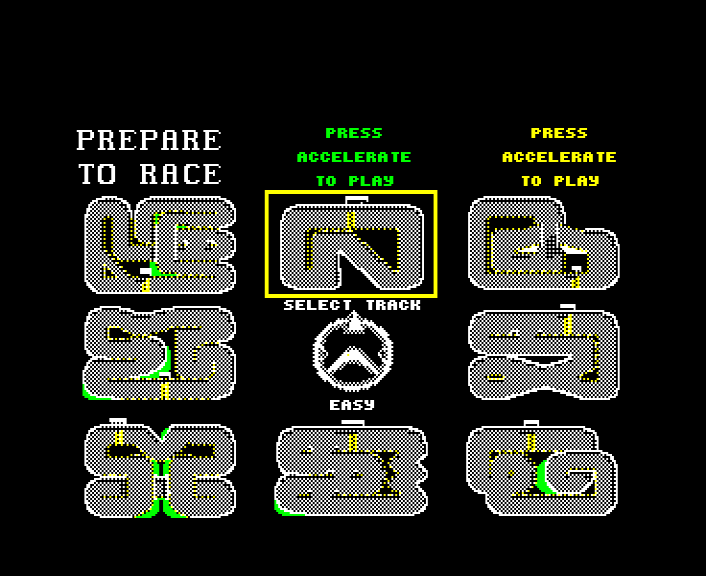
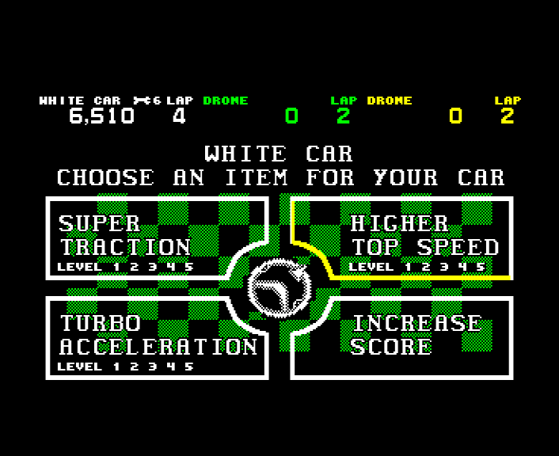

# Super Sprint for the BBC Master 128/Compact

Requires Master 128/Compact. 64 KB of sideways RAM must be available.

Get the latest release here: https://github.com/tom-seddon/super-sprint-beeb/releases/latest

Inside the zip file, there are five files, named similarly to the zip
file: 2 `super-sprint-game` disk image files, 2 `super-sprint-ta` disk
image files, and a README.

# Super Sprint

Use one of the `super-sprint-game` disk images, either the `.ssd` file
(DFS) or `.adl` (ADFS), as appropriate (both contain the same
contents). The disk auto-boots with SHIFT+BREAK.

## Instructions

(loosely adapted from the 8-bit instructions)


Just another racing game? No - this is THE racing game. SUPER SPRINT
lets one, two or three players compete head to head with a bird's-eye
view over eight gruelling tracks. There's plenty of challenge for your
driving skills, with ramps to jump, opening and closing gates, hidden
shortcuts, over- and underpasses, and banked turns. There are random
obstacles to avoid, and golden spanners to collect which can be traded
for custom car features to enhance your vehicle's performance.

To start the race, press one of the accelerate keys:

| Action | White | Green | Yellow       |
|--------|-------|-------|--------------|
| Left   | `Q`   | `,`   | Pad `5`      |
| Right  | `W`   | `.`   | Pad `6`      |
| Accel  | `E`   | `/`   | Pad `DELETE` |

Change the initial track using the left and right keys, and press
accelerate to select it. Additional players can join on this screen by
pressing their accelerate key.



(Additional players can also join on the prepare to race screen that
follows.)

Each race consists of four laps. Beat the drone cars to qualify for
the next race!

Steer your vehicle using the left and right keys, and control its
speed with the accelerator. Hitting the circuit barriers at low speeds
only causes a delay, but on a high-speed impact your car explodes and
respawns after a delay.

On some tracks there are underpasses where you will be steering blind.
Other circuits feature gates which open and close, allowing brief
access to short cuts. Ramps enable you to leap over obstacles.

Random objects will appear on the track from time to time, to be
collected or avoided:

- *Golden Spanner* - for every 4 spanners collected, you can purchase
  a car upgrade at the end of the race
- *Bonus Score Pad* - shows a number which is added to the score of
  the driver that passes over it
- *Oil Slicks* - causes the car to spin out of control
- *Water Slicks* - causes the car to slow down
- *Tornado* - blows the car off course and into a spin

At the end of the race, the winner's circle is displayed, with the
rank, score, and best lap times for each car.


Press accelerate to continue. If a player has accumulated 4 or more
spanners, they can spend 4 spanners on a car upgrade:

- *Super Traction* (5 levels)
- *Higher Top Speed* (5 levels)
- *Turbo Acceleration* (5 levels)
- *Increase Score* (no limit)



At the end of the game, if you qualified for the high score table,
enter your name: use left/right to pick each letter and accelerate to
select it.

## Options

Press `f1` during the initial sequence to access the options screen.

Follow the prompts to change the assigned keys for each car. **The
defaults are recommended** - they have been chosen to avoid ghost
keypresses or clashing keys when playing on a Master 128 or Compact.

(If you change keys, experiment with the new keys on the options
screen. When pressing a key, it will be highlighted - watch for keys
that become stuck or unavailable when doing this. Choose different
keys when this happens; it's an unavoidable hardware issue for which
there is no workaround.)

If playing on an emulator, you may have to experiment to find keys
that work well for multiple players.

----

# Super Sprint (Time Attack)

TODO

----

# Credits

Atari ST version created by State of the Art.

Programming: Nalin Sharma, Martin Green, Jon Steele

Graphics: Chris Gibbs

Sound: Mark Tisdale

BBC Micro version written by Claude Code (with occasional input from Tom Seddon).

----

# Building

(Claude did pretty much all of this. You'd be mostly on your own
here.)

```
git clone --recurse-submodules https://github.com/tom-seddon/super-sprint-beeb.git
cd super-sprint-beeb
make game && make ta
```

The results are:

* Super Sprint: `build/game.ssd` (DFS); `build/game.adl` (ADFS)
* Super Sprint (Time AttacK): `build/ta.ssd` (DFS); `build/ta.adl` (ADFS)

## For AI agents

Start with `CLAUDE.md`: how the project builds, how it's checked, and where everything else is. Where the port
stands is in `docs/plan.md`, the decisions in `docs/decisions.md`, the work done in `JOURNAL.md`. Please don't edit
this README: Tom writes it.
